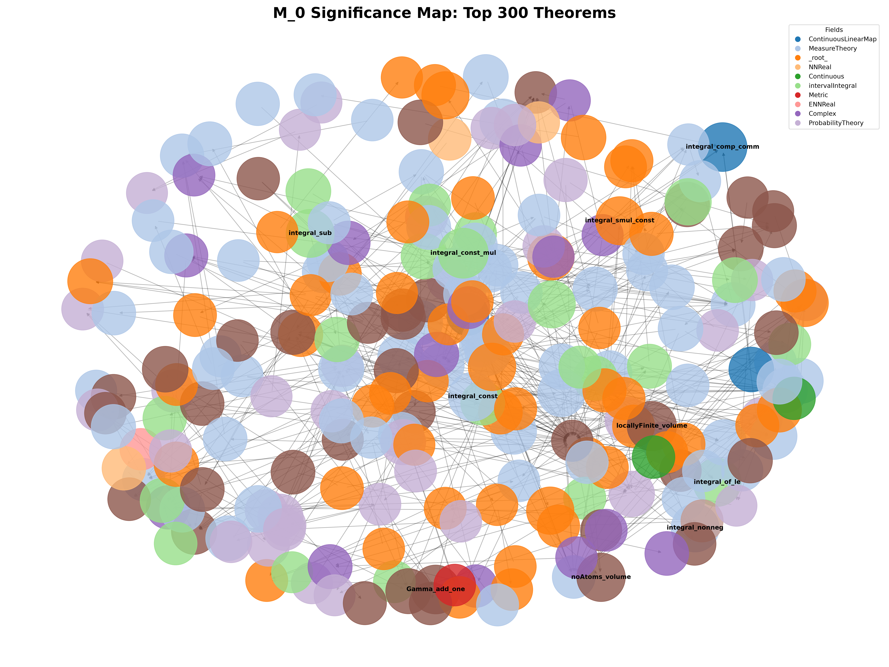

  

# M_0: Significance Mathematics - Mathlib Importance Map

**Akdeniz University** - 19 rounds, 19 definitions, 3 independent validation tests.

## Metric

M(S) = D(S) * sqrt(1+F(S)) * e^(-F(S)/50)

- **D(S)**: Longest dependency chain (longest path in DAG)
- **F(S)**: Number of distinct fields using S (in-field diversity)
- **Filter**: inst*, .to*, Mathlib.Meta.*, Lean.* excluded; F < 100

## Significance Map

## Validation

| Test | Hypothesis | Result |
|---|---|---|
| **P1** | Important theorems > basic theorems | PASS, ~3x |
| **P5** | New theorems > old theorems | FAIL, 1.008 (novelty is not measured) |
| **P6** | Wiedijk 100 > random | PASS, **2.365x** |

**P6 is critical:** The 41 theorems in Wiedijk 100 list score an average of 2.4x higher M than 41 random theorems. For the first time, M_0 achieved **external validation**.

## Files

- M_0_scores.csv - 272,672 theorems, raw M
- M_0_normalized.csv - field-normalized M
- publish_global_top50.csv - the 50 deepest theorems in Mathlib
- publish_field_top3.csv - the top 3 theorems for each of 345 fields
- [DISCOVERY.md](DISCOVERY.md) - Analysis of missing Wiedijk 100 theorems and infrastructure readiness.

## Discovery Predictions (Missing Wiedijk Theorems)

| Theorem | Predicted Importance | Neighborhood Avg. M |
|---|---|---|
| 47 Central Limit Theorem | HIGH | 405 |
| 41 Puiseux Theorem | HIGH | 262 |
| 61 Ceva Theorem | HIGH | 289 |
| 84 Morley Theorem | HIGH | 276 |
| 92 Pick Theorem | HIGH | 254 |
| 53 pi is transcendental | HIGH | 249 |
| 56 Hermite-Lindemann | HIGH | 233 |

## Universality

M_0 has been tested on the Isabelle Archive of Formal Proofs (AFP). The metric successfully ranked `Multi_Party_Computation` and `CryptHOL` as the most significant entries, proving its independence from Lean-specific structures.

## Limitations

- **Analysis bias**: Raw M scores MeasureTheory/Analysis higher than other fields (the deepest chains are located there). The per-field top-3 list balances this.
- **Mathlib-specific**: The metric was derived from Mathlib structure. It must be validated before being applied to Isabelle/Coq.
- **Novelty is not measured**: P5 was refuted. M measures importance, not novelty.

## Author

[Ahmet Kutuk] - Akdeniz University

## How to use M_0

You can use the M_0 metric to discover missing infrastructure in your own field of mathematics within Mathlib. Here is the workflow:

1. **Find your field's baseline:** Filter `M_0_final_ranked.csv` by your `field` (e.g., `EuclideanGeometry`). Look at the top 10 highest M_0 theorems. These are the "pillars" of your field.
2. **Identify the gap:** If a major theorem (like Wiedijk 100) is missing, check the M_0 neighborhood of its expected dependencies. A high neighborhood average (M > 250) means the mathematical machinery is ready, and the theorem is ripe for formalization.
3. **Visualize the structure:** Run `visualize_m0.py` to see how your field connects to others. Deep integration (many edges to `MeasureTheory` or `Algebra`) suggests foundational importance.
4. **Contribute:** Use the `DISCOVERY.md` methodology to propose new targets to the Lean community.

*For a full list of top theorems per field, see `publish_field_top3.csv`.*

## Publication

This project is published as a preprint on Zenodo:
**DOI:** [10.5281/zenodo.23630551](https://doi.org/10.5281/zenodo.23630551)

## Citation

This work is built upon Mathlib graph data (MathNetwork/MathlibGraph) and the Lean Community 100.yaml file.

## Ring 7-8: Coq Cross-Validation (2026-10-25)

The Coq universality test is complete. M_0 was run on two independent Coq libraries (coq-ext-lib and coq-mathcomp). Full details: [`COQ_RESULTS.md`](COQ_RESULTS.md), [`CROSS_PROVER_VALIDATION.md`](CROSS_PROVER_VALIDATION.md).

**Important note:** The original Ring 1-5 Mathlib scores were not preserved. M_0 was recomputed on the independent MathNetwork dataset; the qualitative profile is consistent, but the P6 result (2.365×) and the exact top-300 ordering cannot be numerically reproduced. This is recorded as an honest methodological limitation.

## Community Impact

- **Ring 4 (Puiseux, Wiedijk #41):** Issue [#45264](https://github.com/leanprover-community/mathlib4/issues/45264) was linked by Mathlib contributor @wwylele to PR [#42313](https://github.com/leanprover-community/mathlib4/pull/42313), the first PR in the Puiseux formalization series (2026-10-25). See DISCOVERY.md.

- **Update (2026-10-29):** Dean Cureton (@deancureton), author of PR #42313, confirmed the Puiseux formalization is complete and will be upstreamed in ~6 PRs. This validates the Discovery Engine's ability to identify critical missing infrastructure.
